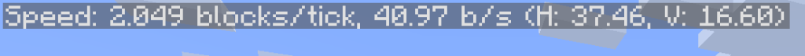

    
    
    
    

# ⚡ Speedometer

> **Player Speed but blocks per second.**

**Active Version Policy:** I build **1 JAR for 1 Version**. Each release is built specifically for a single Minecraft version anchor. Please make sure you download the matching JAR file for your game version.

Every Minecraft player knows the frustration: you press F3, look for your speed, and vanilla gives you `0.215 blocks/tick`. A raw physics calculation unit that means nothing during normal gameplay. Is that fast? Is that slow? How fast are you actually flying with Elytra or riding a horse?

**Speedometer** fixes this foundation. It converts your movement into real-world readable **blocks per second (b/s)**. Powered directly by vanilla's 20 TPS physics engine, it updates dynamically, breaks down horizontal vs vertical velocity, works on mounts and vehicles, and seamlessly consolidates with vanilla's `player_speed` on modern Minecraft versions.

Part of the **Vanilla Outsider Collection** — mods that refine the vanilla experience with modern standards.

---

## 🎬 Showcase Video

<iframe width="560" height="315" src="https://www.youtube-nocookie.com/embed/Y1DDyWD-5es" title="Speedometer Showcase" frameborder="0" allow="accelerometer; autoplay; clipboard-write; encrypted-media; gyroscope; picture-in-picture; web-share" allowfullscreen></iframe>

*Click the player above to watch the mod showcase in action!*

---

## ✨ Features

### ⚡ Native F3 Debug Integration
Speedometer integrates seamlessly into Minecraft's debug display:
- **Modern Versions (1.21.11, 26.x+)**: Registers a dedicated `speedometer` entry directly inside Minecraft's native `DebugScreenEntries` system (`F3 + F6`).
- **Legacy Versions (1.20.1, 1.21.1)**: Hooks directly into the F3 debug screen overlay, appearing immediately when you open F3.

### 🛠️ Smart Display Layouts & Consolidation (F3 + F6)
On versions with Minecraft's debug options menu (`F3 + F6`), choose your preferred display layout:

1. **Speedometer Only** *(Default)*:
   `Speed: 58.79 b/s (H: 58.62, V: 4.47)`
2. **Both Enabled (Smart Consolidation)**:
   `Speed: 2.049 blocks/tick, 40.97 b/s (H: 37.46, V: 16.60)`
3. **Vanilla Player Speed Only**:
   `Speed: 0.215 blocks/tick`

> [!TIP]
> **Smart Consolidation**: When both vanilla's `player_speed` and `speedometer` are enabled in F3 options, they automatically merge into a single clean line to save HUD space.

**Speedometer Only (Standalone):**

  

**Both Enabled (Consolidated):**

  

### 📌 ALWAYS_ON HUD Pinning
Want to track your speed without keeping the entire F3 debug wall open? On supported modern versions, toggle `speedometer` to **`Always`** in the `F3 + F6` menu to keep a minimal speedometer pinned to your screen at all times.

### 📐 Dynamic Scaling & Jitter-Free Physics
Unlike static formatted debug text, Speedometer uses dynamic string sizing that expands and shrinks flawlessly as your velocity changes. By sampling vanilla's pre-calculated velocity vector once per tick and multiplying by 20 TPS, it provides smooth, jitter-free output with **zero performance overhead**.

### ↔️ Horizontal (H) & Vertical (V) Breakdown
Get instant insight into your movement dynamics:
- **Total Speed**: Complete 3D velocity vector magnitude.
- **H (Horizontal)**: Ground, sprinting, and lateral movement speed.
- **V (Vertical)**: Jump height velocity, falling speed, and Elytra pitch rate.

### 🚗 Vehicle & Mount Tracking
Speedometer automatically detects when you are riding a horse, minecart, boat, pig, or strider, tracking the vehicle's actual movement velocity instead of player entity position.

---

## 📦 Installation & Environment

### ⚛️ Environment Support
* [x] **Client-side only**: All functionality runs purely on the client and is fully compatible with vanilla and modded servers.
  * [x] Works in singleplayer
  * [x] Works in multiplayer (you see your own speed)
* [ ] **Server-side only**
* [ ] **Client and server**

### 📋 Dependencies
* **Fabric Loader**
* **Fabric API**
* **Dasik Library**

### 📥 Install Instructions
1. Install **[Fabric Loader](https://fabricmc.net/use/installer/)**.
2. Install **[Fabric API](https://modrinth.com/mod/fabric-api)** and **[Dasik Library](https://modrinth.com/mod/dasik-library)**.
3. Download the matching **Speedometer** JAR for your Minecraft version.
4. Place the JAR in your `.minecraft/mods` folder.
5. Launch Minecraft — press `F3` (or `F3 + F6` to configure layouts on modern versions).

---

## 🔗 Compatibility

| Feature | Support |
| :--- | :---: |
| Singleplayer | ✅ |
| Multiplayer (LAN/Dedicated Server) | ✅ |
| Vanilla Servers | ✅ |
| Dedicated Server Required | ❌ (Client-side mod) |

### 🎮 Version Compatibility

| Minecraft Version | Architecture Status |
| :--- | :---: |
| MC 1.20.1 | ✅ Supported (Legacy Immortal Anchor) |
| MC 1.21.1 | ✅ Supported (Tricky Trials Early Anchor) |
| MC 1.21.11 | ✅ Supported (Winter Drop Transitional Anchor) |
| MC 26.2, 26.3+ | ✅ Supported (Modern Sovereign Anchors) |

---

## 📖 Official Wiki & Documentation

Detailed mechanics, vector calculation breakdowns, and multi-version architecture guides are available on the official documentation portal:
- **[Speedometer Official Wiki](https://dasik-mc-studio.pages.dev/vo-speedometer/)**

---

## ❤ Support

If you enjoy **Speedometer** and the **Vanilla Outsider** philosophy, consider fueling the next update with a coffee!

> [!NOTE]
> **Indonesian Users:** SocioBuzz and Saweria support local payment methods (GoPay, OVO, Dana, QRIS, etc.) if you want to support me without using PayPal/Ko-fi!

---

## 👤 Credits

| Role | Author |
| :--- | :--- |
| **Creator** | Dasik (Rifaditya) |
| **Collection** | Vanilla Outsider |
| **License** | GNU GPLv3 |

---

> [!IMPORTANT]
> This mod is part of the **Vanilla Outsider** collection. You are free to use it in modpacks, videos, and servers.
>
> **Modpack Permissions:** You are free to include this mod in modpacks, **provided the modpack is hosted on the same platform** (e.g. Modrinth).
>
> **Cross-platform distribution is not permitted.** If you download this mod from Modrinth, your modpack must also be published on Modrinth.
